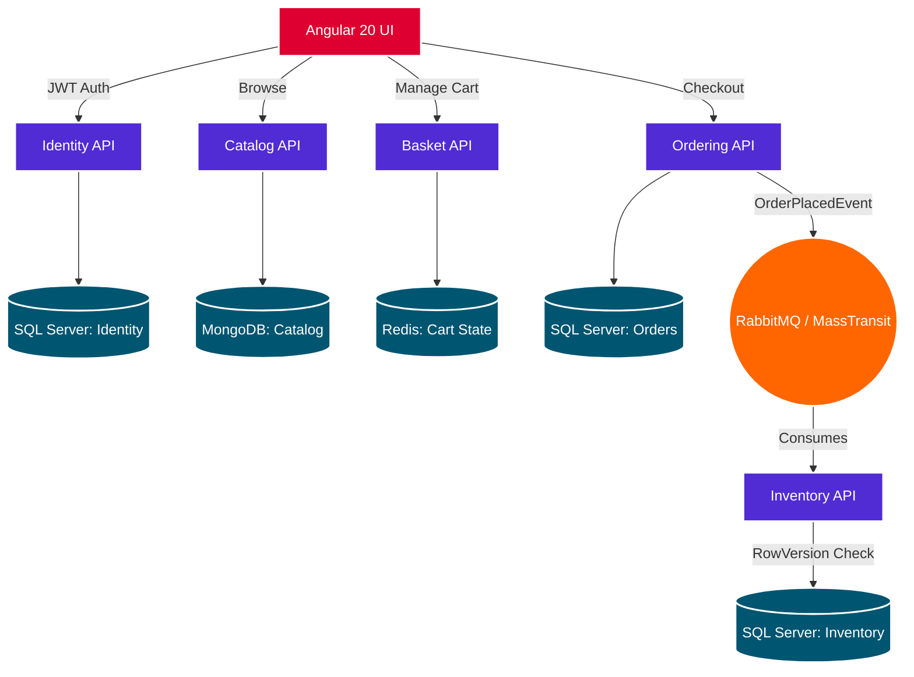

# Syncora - Distributed E-Commerce Platform

Syncora is a full-stack, distributed e-commerce application demonstrating enterprise-grade microservices architecture. Built with **.NET 8** and **Angular 20**, this project showcases advanced backend communication, polyglot persistence, and modern reactive frontend design.

## 🏗️ Architecture Overview

The system is designed around **Clean Architecture** and strict **Domain-Driven Design (DDD)** principles. It is broken down into autonomous microservices, each managing its own database and communicating asynchronously via message brokers to ensure high availability and eventual consistency.

### System Architecture Diagram



### Microservices
* **Identity API:** Manages user authentication, registration, and Role-Based Access Control (RBAC) issuing JWTs.
* **Catalog API:** A high-performance, read-heavy service utilizing NoSQL (MongoDB) to manage polymorphic product documents and categories.
* **Basket API:** Manages transient, user-specific shopping cart state using distributed caching (Redis).
* **Ordering API:** Handles complex business logic for checkout processes using CQRS and SQL Server.
* **Inventory API:** Manages stock levels utilizing **Optimistic Concurrency** (RowVersion) to prevent overselling during high-traffic events.

## 🚀 Technology Stack

### Backend
* **Framework:** .NET 8 Web API
* **Architecture:** Microservices, Clean Architecture, CQRS (MediatR), DDD
* **Communication:** RabbitMQ, MassTransit (Event-Driven Architecture)
* **Databases:**
  * SQL Server (Entity Framework Core) - *Ordering, Inventory, Identity*
  * MongoDB - *Catalog*
  * Redis - *Basket*
* **Security:** JWT (JSON Web Tokens), Role-Based Access Control

### Frontend
* **Framework:** Angular 20 (Standalone Components, Zoneless Change Detection)
* **State Management:** Angular Signals (Modern reactive state)
* **Styling:** Bootstrap 5, SCSS, Custom Theming
* **Features:** Lazy Loading, Functional Route Guards, JWT HTTP Interceptors

## ✨ Key Technical Highlights

* **Event-Driven Integration:** Services are fully decoupled. Successful orders publish integration events via RabbitMQ/MassTransit to automatically update inventory levels.
* **Optimistic Concurrency Control:** The Inventory database utilizes `byte[] RowVersion` to guarantee ACID compliance. If there is 1 item left in stock, it is mathematically impossible for two concurrent users to purchase it simultaneously.
* **Polyglot Persistence:** Data storage is tailored to the domain. Relational data uses SQL, unstructured data uses MongoDB, and transient session data uses Redis with automatic Time-To-Live (TTL).
* **Signals-Based UI:** The Angular frontend completely eschews legacy state management in favor of native Angular Signals (`signal`, `computed`, `effect`) for instantaneous UI updates.

## 🛠️ Getting Started (Local Development)

### Prerequisites
* [.NET 8 SDK](https://dotnet.microsoft.com/download/dotnet/8.0)
* [Node.js & npm](https://nodejs.org/) (v18+)
* [Docker Desktop](https://www.docker.com/products/docker-desktop/)

### 1. Infrastructure Setup
The project uses Docker to spin up lightweight infrastructure components. Open a terminal in the root directory and run:

```bash
docker-compose up -d
```
*Note: This spins up the Redis container (port `6379`) and RedisInsight (port `8001`). Ensure your local instances of SQL Server, MongoDB, and RabbitMQ are running.*

### 2. Backend Setup
The Entity Framework Core configurations are set up to automatically create the databases and apply migrations upon startup.

Ensure RabbitMQ is running locally on `localhost` with the default `guest`/`guest` credentials. 

Open the solution in Visual Studio or Rider, set the microservices to **Multiple Startup Projects**, and run them. 

### 3. Frontend Setup
Navigate to the Angular client folder:

```bash
cd syncora-client
npm install
npm start
```
The application will be available at `http://localhost:4200`.

## 🤝 Contact
Designed and developed as a comprehensive architectural portfolio piece. Open to discussions on distributed systems, .NET architecture, and modern frontend development.